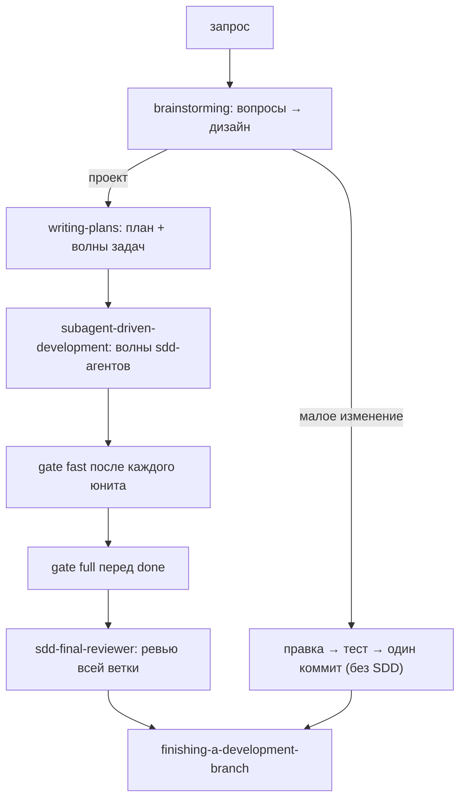

# omp-agent-persona - Developer-персона для Oh My Pi (omp)

Developer-персона: SDD-workflow (superpowers) + детерминированные
quality-гейты (eng-gates). Для домашнего
использования с любыми доступными провайдерами моделей.

## Из чего состоит пайплайн

Полный цикл разработки:



Составные части:

| Слой | Что делает | Где живёт |
|---|---|---|
| Разведка | параллельные `scout`-агенты (один `task`-вызов, скаут на направление) перед планированием большой задачи | бандл omp + superpowers |
| Дизайн и план | `brainstorming` → `writing-plans`: вопросы по одному, короткий дизайн, план `docs/plans/<date>-<name>.md` с волнами | плагин superpowers |
| Реализация | `subagent-driven-development`: свежий `sdd-implementer` на задачу (TDD, коммит, report-file), параллельные волны в git-worktree | плагин superpowers |
| Ревью кода | `sdd-reviewer` (спека+качество, structured output), `sdd-rereviewer` (вердикт по правкам), `sdd-escalation-implementer` (3-й раунд фикс), `sdd-final-reviewer` (вся ветка) | плагин superpowers |
| Quality-гейты | `gate fast` на юните, `gate full` перед done; guard'ы от ослабления гейтов | `skills/eng-gates/` этого репо |
| Финал | `finishing-a-development-branch`: merge / PR / discard | плагин superpowers |

Ключевая идея: контроллер (сессия) не пишет код - он супервайзит свежих
субагентов с изолированным контекстом на каждую задачу. Результат агента
валидируется **детерминированными инструментами**, а не мнением модели.

## Инструменты для quality-чеков

Матрица по языкам и этапам (полная версия - в `AGENTS.md`):

| Что проверяем | Rust | Python | JS/TS | Этап |
|---|---|---|---|---|
| Формат | rustfmt | ruff format | eslint/prettier | fast |
| Линт | clippy `-D warnings` | ruff check | eslint `--max-warnings 0` | fast |
| Типы | clippy | pyright strict | tsc `--noEmit` | fast |
| Тесты | cargo-nextest | pytest `-q -x` | vitest run | fast |
| Границы модулей | workspace-крейты + cargo-deny (bans) | import-linter | dependency-cruiser | fast |
| Мёртвый код и зависимости | cargo-machete | deptry | knip | full |
| Публичный API | cargo-semver-checks (только published-крейты) | - | api-extractor (только библиотеки) | full |
| Сложность | clippy::cognitive_complexity | ruff C901/PLR091x | eslint complexity | fast |
| CRAP-скор | crapper (ub-набор) | crapper | crapper | full, точечно |
| Дубликация | dryer | dryer | dryer | full, точечно |
| Мутационное тестирование | cargo-mutants или mutator | mutmut или mutator | Stryker или mutator | full, точечно |
| Микробенчмарки | divan (CodSpeed-режим) или criterion | pytest-codspeed или pytest-benchmark | tinybench | full, только hot-path |
| Профилирование (не гейт) | flamegraph, DHAT, samply | py-spy, scalene, memray | node `--cpu-prof` | по подозрению |

Правила баланса:

- **fast (90% юнитов)** - формат+линт+типы+тесты+границы, секунды, только
  изменённые файлы. Не начинать следующий юнит, пока fast красный.
- **full (перед done/ревью/пушем)** - плюс мёртвый код, semver/api-extractor
  (только публичные API), CRAP/дубликация/мутации точечно (худший файл, не
  весь репо), бенчмарки только если юнит трогал hot-path.
- **Профилировщики никогда не в гейтах**: wall-clock на шумной машине - не
  гейт. Детерминированные альтернативы: CodSpeed simulation, gungraun
  (Linux), сохранённый baseline + budget.
- **Не стакать линтеры**: ruff закрывает формат+линт+сложность Python;
  eslint - JS/TS. Второй линтер поверх - излишек.
- CI (шаблон `ci-github.yml` в скилле): fast на PR, full на merge в main.

## Состав репозитория

- `persona-dev.yml` - конфиг-оверлей (`omp --config persona-dev.yml`):
- `persona-dev-prompt.md` - приложение к системному промпту.
  (`--append-system-prompt`): явные разрешения на `gate.py approve` и
  `install-tools.sh --python --ub`.
- `AGENTS.md` - контекст-файл: workflow-правила (скаут-разведка,
  SDD-путь, eng-gates после юнита, ask-don't-guess, search-before-code,
  матрица инструментов, token-дисциплина).
- `skills/eng-gates/` - скилл гейтов целиком: `gate.py`, `install-tools.sh`,
  шаблоны конфигов (rust/python/ts/common), CI-шаблон.
- `agents/` - референс-копии бандлованных агентов omp (scout, reviewer,
  security-reviewer, sonic, task) для кастомизации.
- `scripts/omp-dev.sh` - лаунчер: `--config … --append-system-prompt …`.
- `docs/token-costs.md` - анализ токен-затрат для моделей.

## Установка (любая машина)

```bash
# 1. omp должен быть установлен (https://github.com/can1357/oh-my-pi)
omp --version

# 2. плагин superpowers: SDD-агенты и скиллы
omp plugin install @loneexile/omp-superpowers

# 3. эта персона - скопировать/склонировать куда угодно, затем:
./scripts/omp-dev.sh            # или добавить в шелл функцию:
# omp-dev() { command /path/to/this/repo/scripts/omp-dev.sh "$@"; }

# 4. инструменты гейтов (один раз, при первом кодовом юните):
bash skills/eng-gates/scripts/install-tools.sh --python --ub
```

5. Флаги SDD-инфраструктуры (в `~/.omp/agent/config.yml`):
   `task.enableLsp: true`, `astGrep.enabled: true` (активируют lsp/ast_grep
   у sdd-*-субагентов), `task.enableEffort: true` (диспетчеризация с
   `effort: "hi"` на high-risk ревью), `task.showResolvedModelBadge: true`
   (видно, какая модель реально бежала). Модели sdd-мест маппятся через
   `task.agentModelOverrides` - см. `docs/token-costs.md`.

Требования: Python ≥3.11 для gate.py (tomllib); рекомендуется uv.

## Наслоение контекста

omp грузит **глобальный** контекст из `~/.omp/agent/AGENTS.md` в каждой
сессии плюс **проектный** `AGENTS.md` из cwd. `AGENTS.md` этого репо -
проектный слой. На чистой домашней машине глобального файла нет: работайте
в чекауте репо (или его родительском каталоге), либо скопируйте `AGENTS.md`
в `~/.omp/agent/AGENTS.md`, чтобы правила стали глобальными.

## Проверка, что всё загрузилось

```bash
./scripts/omp-dev.sh -p --no-session 'List the agent type names your `task` tool offers, comma-separated'
# ожидание: sdd-*, reviewer, scout, security-reviewer, sonic, task, …
```

## Анализ токен-затрат

Измерено 2026-10-30 на оригинальном сетапе; числа - оценка байт/4.
Детали и рычаги - в `docs/token-costs.md`.

| Потребитель | ~Токенов | Частота | Рычаг оптимизации |
| :--- | :--- | :--- | :--- |
| Контекст `AGENTS.md` | 1.9k | Каждая сессия | Уже урезан до минимума |
| Bootstrap superpowers | 0.8k | Каждая сессия | Оставить только в dev-персоне |
| Описания скиллов (19 dev) | ~1.3k | Каждая сессия | Неизбежно; тела подгружаются по требованию |
| Промпты SDD-этапов | 0.6–1.6k | Диспетчеризация | Фиксированы этапом; не раздувать брифы |
| Бриф + контекст субагента | **Главный драйвер** | На задачу | Один бриф = одна задача; батчить однотипные правки |

Ключевой фактор стоимости: количество вызовов × объем контекста.
Дешевые модели часто требуют в 2–3 раза больше итераций для решения сложных задач, что в итоге делает их дороже. Замеры на реальном ре-ревью подтверждают это: обработка Flash заняла 100 секунд и 4 хода, тогда как Sonnet справился за 50 секунд в один ход.
Рекомендация:
Mid-tier модели: используйте как базовый стандарт для код-ревью и реализации задач.
Дешевые модели: применяйте исключительно для транскрипции.


## Лицензия

MIT для собственных файлов репо. Скрипты eng-gates включены как есть из
локальной дистрибуции скилла. Плагин superpowers - апстрим
(@loneexile/omp-superpowers, MIT), здесь не вендорятся и ставятся через omp.